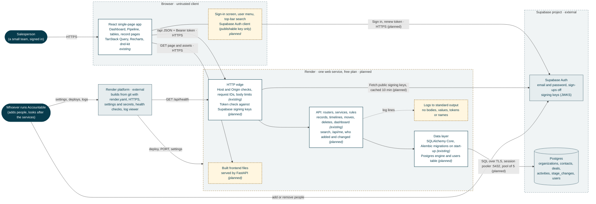
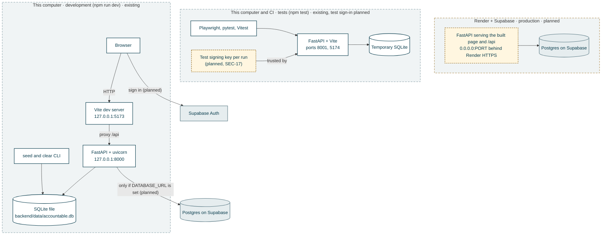

# High-level solution architecture: Accountable

| | |
|---|---|
| Status | Drawn 26 Nov 2026, on branch `mvp-multiuser` |
| Describes | Accountable `v0.1.0` as built, plus the change `mvp-multiuser` as the spec describes it (to be `v0.2.0`) |
| Sources | `AGENTS.md`; `docs/spec.md` and the area files in `docs/specs/` (mainly `architecture.md`, `api.md`, `data.md`, `security.md`, `reliability.md`, `operations.md`, `users.md`, `search.md`, `governance.md`); `docs/changes/mvp-multiuser/intent.md`; `docs/TECH_STACK.md`; the code in `backend/`, `frontend/` and `scripts/` |
| Authority | The spec. This page is a picture of it and adds no decisions. Where it and the spec differ, the spec wins. |

**Existing or planned.** Accountable today (`v0.1.0`) runs on one computer, with SQLite and no sign-in. The hosted, multi-user design comes from the change `mvp-multiuser`: it's approved in its intent and written into the spec, but has **no plan and no code yet**. Every part marked *planned* below is in the spec only.

## 1. Container diagram (C4 level 2): the hosted app, as specified

Exported as [`high-level-architecture.svg`](high-level-architecture.svg) and [`high-level-architecture.png`](high-level-architecture.png). The Mermaid below is the source.

**Legend**

| Notation | Meaning |
|---|---|
| White box, solid Midnight edge | Existing: in the code today (`v0.1.0`). Boxes that mix both say which parts are *existing* and which *planned*. |
| Cream box, dashed brown edge | Planned: in the spec for `mvp-multiuser`, not built yet |
| Grey box | External: run by Supabase or Render, outside Accountable's code |
| Cylinder | Database |
| Dashed outline around a group | A trust or deployment boundary |
| Solid arrow | A synchronous request and its answer (HTTP, HTTPS or SQL) |
| Dotted arrow | Written out, with no answer (log lines) |
| Rounded dark box | A person |

There's no asynchronous messaging anywhere: no queue, event broker, webhook or background worker (spec 8). Every interaction is a synchronous request.

## 2. Runtime environments

The same backend and frontend code runs in three places (spec DEP-1). Only *production* is hosted. Exported as [`runtime-environments.svg`](runtime-environments.svg) and [`runtime-environments.png`](runtime-environments.png).

The tests never reach Supabase or the network, and CI needs no secrets (AC15, V-E00). The seed and clear commands only ever touch a local SQLite file (R4, E-6), and data loaded into Supabase is never bulk-deleted (E-8).

## 3. Components and responsibilities

| Component | Status | Responsible for | Not responsible for | Spec |
|---|---|---|---|---|
| React single-page app (`frontend/`) | Existing | Screens, forms, quick client-side checks, table search and sort, optimistic pipeline moves with rollback, formatting. Only `src/api/` calls `fetch`. | Anything authoritative: validation, stage rules, figures and search results come from the API | 7.1, ENG-1 |
| Sign-in screen, user menu, top-bar search, auth client (`src/auth/`) | Planned | Signing in through Supabase Auth with the publishable key, renewing the token, sending it on every API request, the theme choice, global search | Holding any secret (SEC-15) | 3.11, 3.13, SEC-15 |
| HTTP edge (`app/security.py`, `app/logging.py`, `app/errors.py`) | Existing | Host and Origin checks, JSON-only and body limits, request IDs, the error format | | SEC-1–SEC-3, SEC-7, 5.2 |
| Token check (`app/auth.py`) | Planned | Checking each token's signature, issuer, audience and expiry against Supabase's cached signing keys, and taking the person from the token only | Signing people in | SEC-13, SEC-14, ADR-023 |
| Routers (`app/routers/`) | Existing (search and `/api/me` planned) | HTTP only | SQL and business rules | 7.1, 5.3 |
| Services and rules (`app/services/`, `app/rules.py`) | Existing (search and attribution planned) | Use cases, one transaction per request. Rules are pure functions. | HTTP details | 7.1, REL-2 |
| Data layer and migrations (`app/db.py`, `backend/migrations/`) | Existing on SQLite. Postgres engine, `users` table and who-added columns planned. | Table definitions, connection settings, migrations on start-up, SQLAlchemy Core only | Business logic | 6, ENG-4, ADR-020 |
| Built-frontend serving | Planned | FastAPI serving the built page, so one origin serves page and API | | 7.4, ADR-021 |
| Seed and clear CLI (`app/cli.py`, `app/seed.py`) | Existing (refusing Postgres planned) | Sample data for a new database, and reset and empty for a local one | Touching Supabase's data | R4, E-6, E-8 |
| Supabase Auth | External | Email and password sign-in, tokens, signing keys, people's accounts | Sign-ups, which are turned off | 8, SEC-16 |
| Postgres on Supabase | External (use planned) | The team's shared data | | 6.1, DEP-11 |
| Render | External (use planned) | Building from git with `render.yaml`, HTTPS, settings, health checks, logs | | DEP-8 |

## 4. Key request and data flows

1. **Signing in (planned).** The browser shows the sign-in screen to anyone without a session. The auth client sends the email and password to Supabase Auth, which returns an access token. From then on, the client renews the token before it runs out (R100–R102, R108).
2. **An API request.** The SPA calls `/api/...` on its own origin, with `Authorization: Bearer <token>` *(planned)*. The edge checks Host and Origin *(existing)*, then the token *(planned)*. The router parses the request, the service runs it in one transaction, and the data layer writes to SQLite today, or to Postgres once planned. The answer is JSON in the common error or record shape (5.1–5.3).
3. **Who added and changed (planned).** On each signed-in request, the service adds or updates the person's row in `users` from the token. Creates and updates set `created_by` and `updated_by` from the token, never from the body (R110, ADR-022).
4. **Pipeline drop (existing).** The SPA updates its cache straight away, calls `POST /api/deals/{id}/move`, and puts the cache back if the call fails (R63, R64, 5.4).
5. **Search (planned).** After a 200 ms pause, the SPA calls `GET /api/search?q=` and cancels the previous search. The service matches names in any case, in the same way on SQLite and Postgres (R121, R125, ADR-024).
6. **Deploy and start (planned).** A push to the deployed branch makes Render build the app from `render.yaml`. At start-up, the app runs the Alembic migrations, and a new database gets the sample data, then uvicorn serves on `PORT`. Render's health check calls `/api/health` (DEP-4, DEP-8).

## 5. API and integration patterns

- **One unversioned JSON API**, `/api`, with the bundled frontend as its only client (ADR-009). It's REST-style resources plus a `move` command, a dashboard read model, `search` and `me` (5.3–5.5).
- **Same origin everywhere:** the Vite proxy in development, and FastAPI serving the built page on Render. So there's no CORS, and the Host and Origin checks hold (ADR-021, SEC-3).
- **Integrations, all synchronous:** Supabase Auth over HTTPS (from the browser to sign in, from the backend for the signing keys), Postgres over TLS through Supabase's session pooler, and Render's health check. No webhooks, queues or telemetry (8).

## 6. Authentication, authorization and trust boundaries

| Boundary | What crosses it | Protection |
|---|---|---|
| Browser → Render | Page, assets, API calls with a token | HTTPS from Render. Host and Origin checks. Token check on every route but health (SEC-2, SEC-3, SEC-13). |
| Browser → Supabase Auth | Email, password, tokens | HTTPS. The publishable key only; no secret key in the browser (SEC-15). No sign-up (SEC-16). |
| Render → Supabase | SQL, and fetching the signing keys | TLS through the session pooler. The only secret is the database password in `DATABASE_URL`, in Render's settings (SEC-9). |
| This computer (development) | | Servers on `127.0.0.1` only (SEC-1, ADR-002) |
| Tests | Test tokens | A per-run signing key, trusted only when `ACCOUNTABLE_TEST_AUTH_KEYS` is set. Start-up refuses it alongside `DATABASE_URL` (SEC-17, ADR-025). |

- **Authentication:** Supabase Auth with an email and password. The person is taken only from the token's `sub`, `email` and `user_metadata.name` (SEC-14).
- **Authorization:** being signed in. Everyone can do everything, and there are no roles (R115, SEC-4).
- **Audit:** each organization, contact, deal and activity records who added it and who last changed it (3.12). Stage changes and deletes record no person, and there's no separate audit log (16.5).

## 7. Data ownership and persistence

- **Accountable owns** the five business tables and `users`, through SQLAlchemy Core and Alembic: one schema for SQLite and Postgres (6.1, ADR-020).
- **Supabase owns** people's accounts and passwords. Accountable keeps only each person's ID, email and display name, from their token (ADR-022).
- **Where the data lives:** production data is in Postgres on Supabase, development uses the local SQLite file or `DATABASE_URL`, and the tests use temporary SQLite files.
- **Keeping the hosted data:** once data is loaded into Supabase, it's never bulk-deleted, reseeded or truncated. Single deletes in the app, with their warning, still work (E-8, R30–R36).
- **Personal data:** contacts' details and the team's names and emails. They're stored in Supabase's region, travel only over HTTPS or TLS, and are never logged (6.6, SEC-8).

## 8. Reliability and scalability

- **Transactions:** one per request, all or nothing. Durability is WAL and `synchronous = FULL` on SQLite, and Postgres's own commits (REL-1, REL-2).
- **Failures:**
  - A locked database answers 503 `busy`, and an unreachable one 503 `database_unavailable`, with bounded timeouts (REL-4, REL-6, REL-13).
  - Changes are never retried automatically, and reads are retried once (REL-5).
  - Two people editing the same record: the last write wins, accepted for a small team (ADR-003, 16.2).
- **Scale:**
  - The design targets up to 10 people signed in at once and the data volume in NFR-1, with no design limit below 10 × that volume (NFR-13, NFR-14).
  - Lists load in full (ADR-007). Pool size and paging would need revisiting well before 10 ×.
- **Free plans:**
  - Render's service sleeps after 15 minutes idle, so the next load waits up to about a minute (REL-14).
  - Supabase pauses a free project after a week unused, and its backups are limited (16.2, DEP-6).

## 9. Extensibility

These are the approved places where Accountable is expected to grow:

- **New capabilities as service modules**, behind the router, service and rules boundaries, and the one `src/api/` client (ENG-1). The planned search and `/api/me` follow this pattern.
- **One schema and migrations for both databases**, so new tables reach Postgres and SQLite together (ADR-020).
- **People as a table** (`users`), ready for roles and permissions, and a fuller record of who did what, both open questions (16.5).
- **A versioned API** (`/api/v2`) if it ever gets clients other than the frontend (ADR-009).
- **The Business OS direction** (1.2) is the product's aim, with no components designed for it yet. None is drawn.

## 10. Observability and operations

- **Logs:**
  - One line per request: request ID, method, path template, status and duration. Never bodies, field values, tokens, emails or names (OBS-1, SEC-8).
  - Locally, a rotating file plus the terminal. On Render, standard output only, kept in Render's log viewer (OBS-2).
- **Request IDs:** every response carries `X-Request-ID`, and error screens show "Reference: 9f2c" (OBS-3).
- **Health:** `GET /api/health`, with no sign-in, is Render's health check (OBS-5, 5.5).
- **No metrics, traces or alerts,** by decision: there's no one on call (ADR-014). Render's dashboard shows whether the service is up.
- **The runbook** for the hosted app (sign-in failures, adding and removing people, sleep, pause, deploys) is in spec 12.

## 11. Assumptions, gaps and open questions

**Missing or not yet written**

- **No `plan.md`** for `mvp-multiuser` (`docs/changes/mvp-multiuser/` holds only `intent.md`). The planned parts come from the spec alone, and component names such as `app/auth.py` and `src/auth/` are the spec's, not code that exists.
- **No `render.yaml`** in the repository yet (DEP-8 describes it).
- **No standalone ADR files.** The decisions are ADR-001 to ADR-026 and E-1 to E-8 in `docs/specs/governance.md`, section 16.3.

**Differences between the repository and the spec**

- **Not yet in the code:** sign-in, the token check, search, `/api/me`, who added and changed, the Postgres engine, the `users` table, serving the built frontend, and the commands `npm run build`, `npm run start` and `npm run dev:test`. That's expected before the plan.
- **Uncommitted dependencies:** `pyproject.toml` adds `supabase`, `flask` and `dotenv`, which the spec's design doesn't use. FastAPI serves the app, and the backend checks tokens itself (ADR-023). They come from `course/check_supabase.py`.

**Assumptions and open questions carried from the spec** (16.1, 16.2 and 16.5)

- One team time zone, set with `TZ` on Render (A-9, ADR-026).
- Last write wins for a small team (ADR-003).
- The default theme stays Light (R91).
- There's no staging database (DEP-1).
- Postgres behavior is checked by hand only (V-M08).
- The limits of the free plans (REL-14, DEP-6).
- Sample records are shown as "Added by Sample data" (R113).
- The JWT library and the Supabase Auth client are dependencies the plan must justify (ENG-5).

**Exports**

- The SVG and PNG files beside this page were rendered from the Mermaid source with `@mermaid-js/mermaid-cli` 12.2.0, using the installed Chrome. It was installed outside the project, so the project's dependencies didn't change. After changing a diagram, render its files again, or delete them so they don't go stale. The Mermaid source is the authority.
