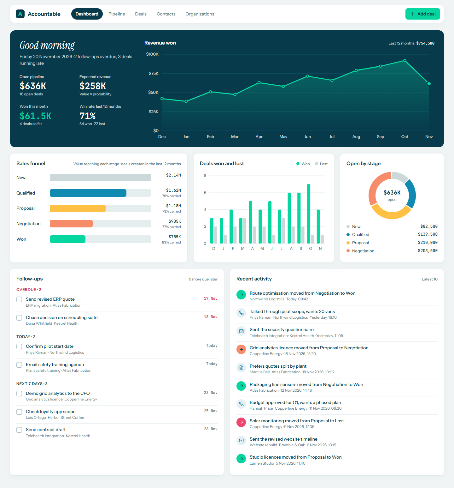
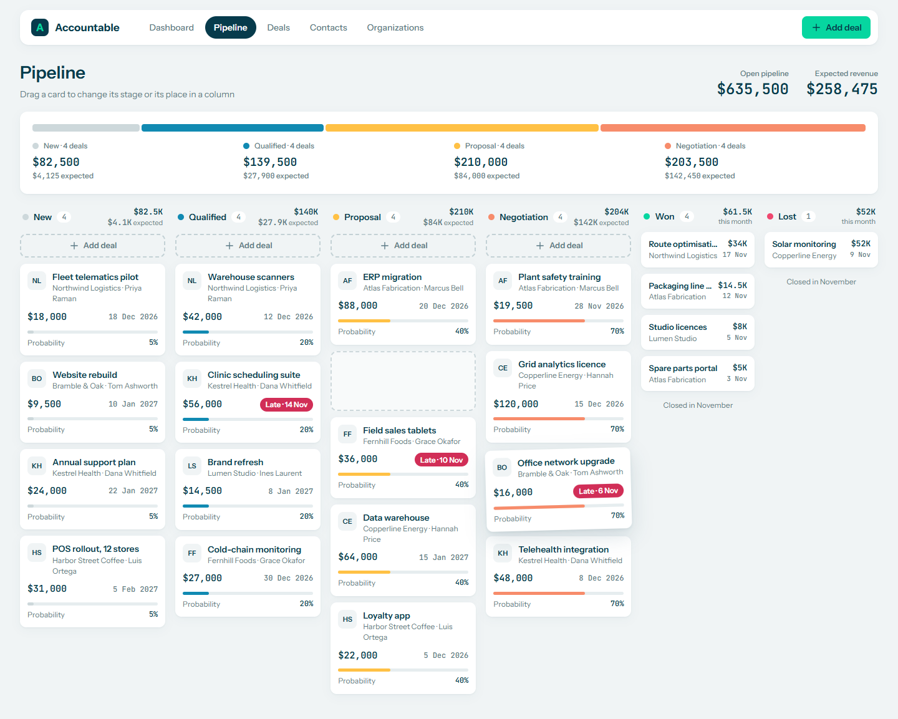
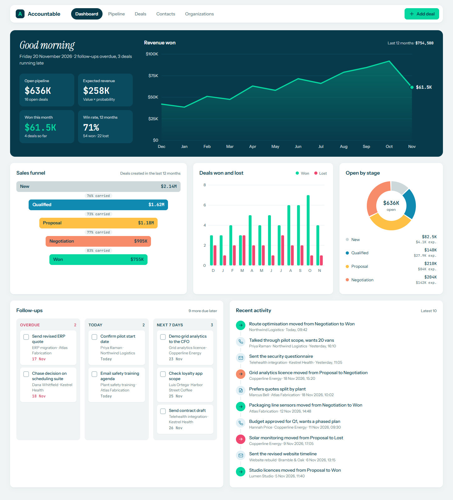
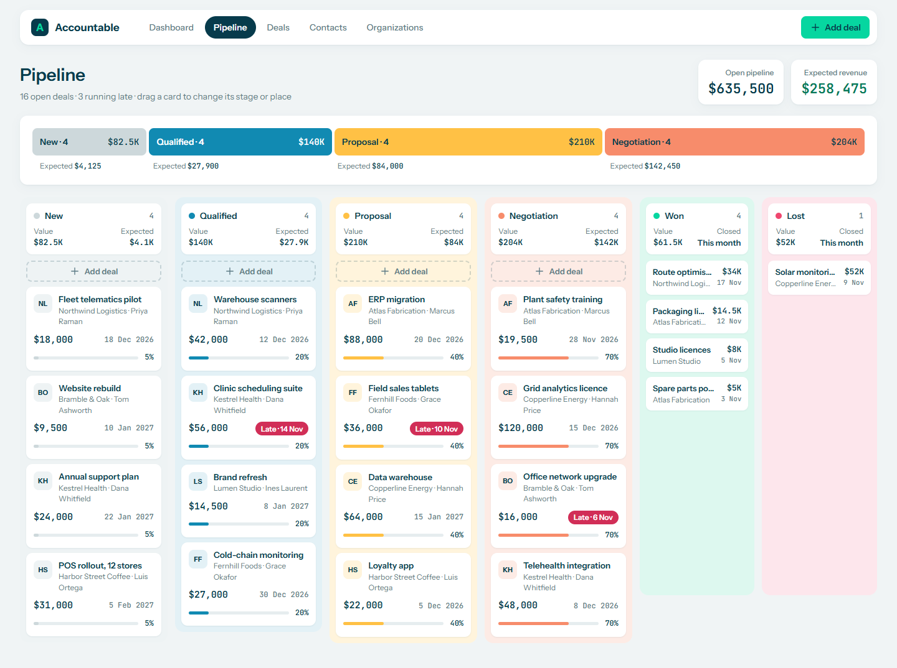

# Mockups: dashboard and pipeline

These are two mockups of the MVP's dashboard and pipeline, built from `docs/spec.md` (version 2.0) and the brand skill. Both follow the spec's layout exactly:

- the floating top bar, with no avatar or search
- the Midnight hero panel, then the funnel, won/lost bars and donut, then follow-ups beside recent activity
- the pipeline's stage strip above six columns, with narrower Won and Lost columns showing this month only (R60)

They differ only in visual treatment, so either can be built from the spec as written.

**Chosen: mockup 1.** On 21 Nov 2026 the product owner picked mockup 1 as the visual reference. `docs/spec.md` and `docs/plan.md` now point to it. Mockup 2 is kept for reference only.

Each folder has the HTML and a Playwright screenshot of each page, taken in Google Chrome at 1440px wide with no console errors. Both use the same made-up sample data from `shared/`, fixed at Friday 20 November 2026. Open any `.html` file straight in a browser. The fonts come from Google Fonts, so the mockups need the internet. The real app bundles them (R2).

## 1. Spec reference (`1-spec-reference/`)

The spec read literally:

- The hero's four figures sit straight on the Midnight panel.
- The revenue line has a dot for each month.
- The funnel is a set of bars on grey tracks, with the percentage carried over from the stage before.
- Lost deals are Sea Mist beside the won bars.
- Follow-ups are one list in three groups.
- On the pipeline, columns sit straight on the page, and cards have a grey initials square and a labeled probability meter.
- It also shows a card being dragged (in Negotiation) and its drop gap (in Proposal).

## 2. Lanes and tiles (`2-lanes-and-tiles/`)

The same layout with more structure:

- The hero's figures sit in dark tiles.
- The revenue line has no dots and labels the current month's value at its end.
- The funnel tapers, with "carried" chips between stages.
- Lost deals are Raspberry, matching the Lost stage color.
- The donut lists expected revenue too.
- Follow-ups show as three side-by-side groups.
- Recent activity is a connected timeline.
- On the pipeline, the stage strip names each stage inside its segment, each column sits on a lane tinted in its stage color, and the initials square takes the stage tint.

## Points the mockups raise for the spec

- **Badge text contrast.** Spec 3.9 set badges at 12px/600 with white text on Raspberry and Cerulean, but only allowed white on those colors for bold text of 14px or more. The product owner chose darker fills on 21 Nov 2026 (ADR-017). Badges stay 12px, and the white-text ones use `--raspberry-text` or `--cerulean-text`. Both mockups' Late badges now use the darker Raspberry, and the screenshots were re-taken.
- **Long names in Won and Lost.** In the narrower closed columns, longer deal and organization names are cut short with an ellipsis, as R60 and spec 3.9 allow. The full name is one click away.
- **Visual reference.** Spec 3.9 and `docs/plan.md` pointed to the removed `docs/mockups/b-hero-topnav/`. They now point to mockup 1.
