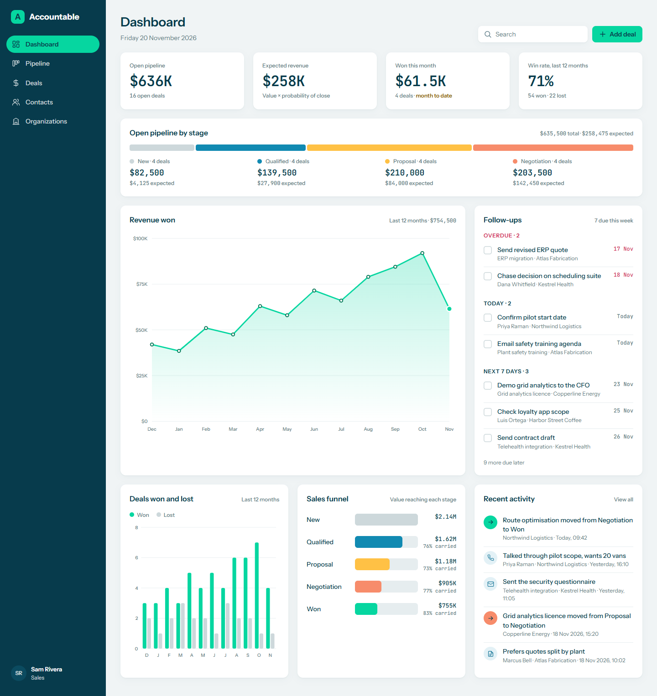
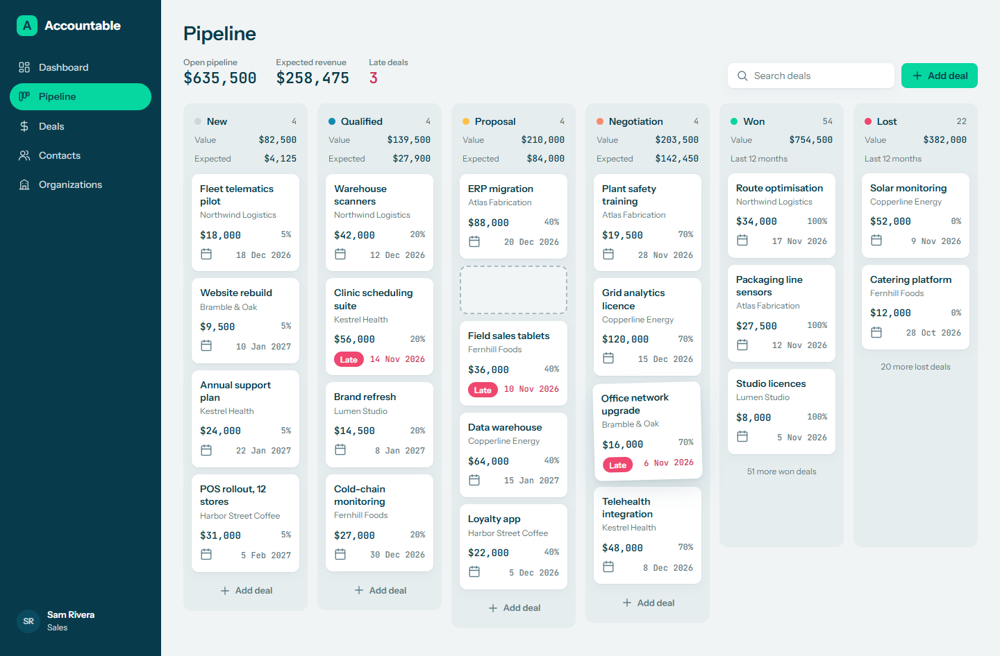
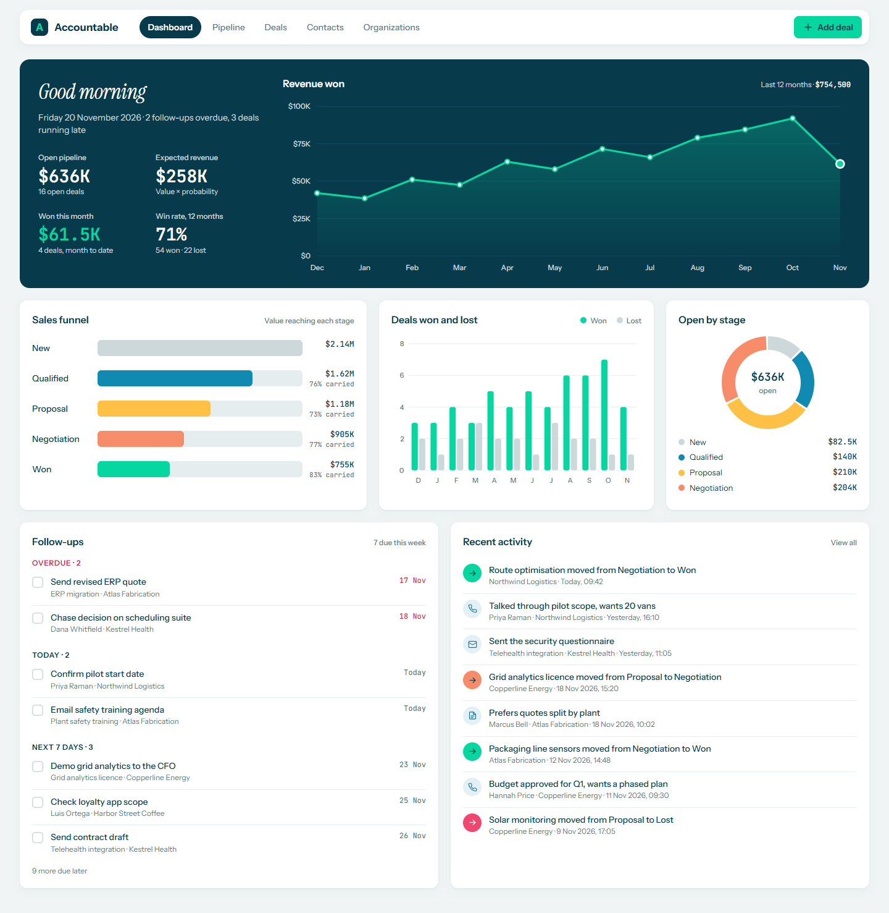
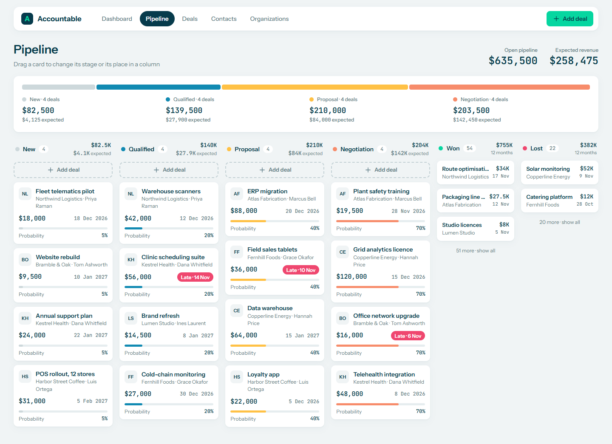
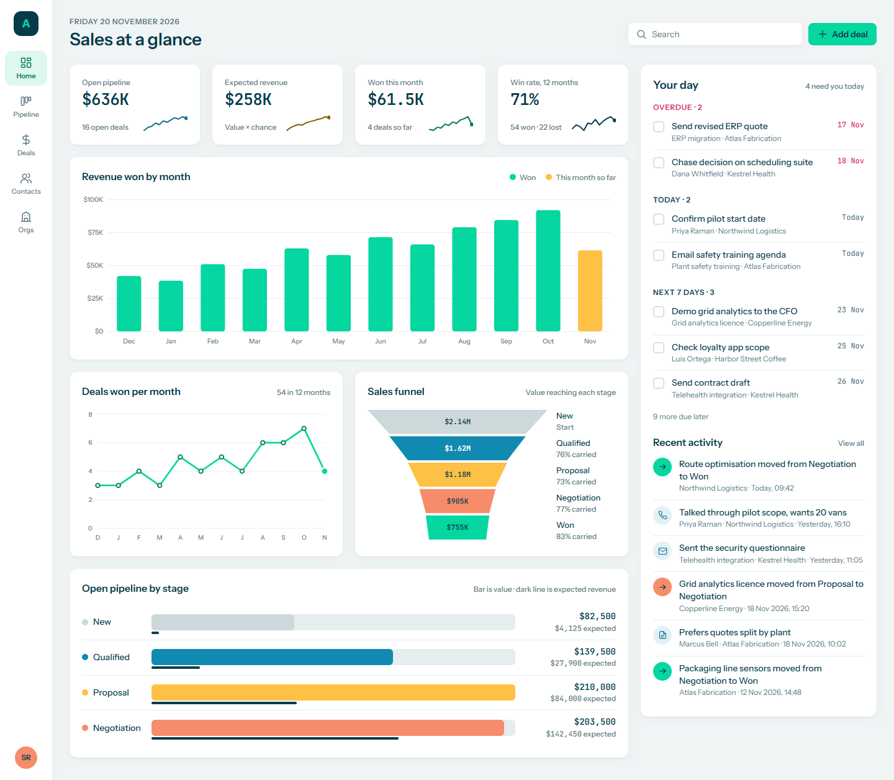
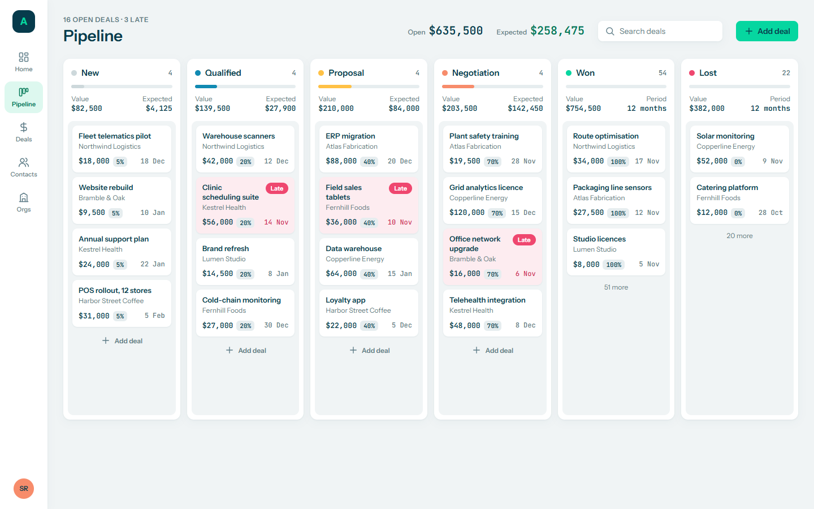

# Mockups: dashboard and pipeline

These are three design directions for the MVP's dashboard and pipeline, built from `docs/spec.md` and the brand guidelines. Each folder has the HTML and a Playwright screenshot of each page, taken at 1440px wide in Google Chrome with no console errors. All three use the same made-up sample data, fixed at Friday 20 November 2026, so they can be compared side by side.

**Chosen: B.** On 2026-11-20 the project owner picked mockup B, and `docs/spec.md` now follows it. B was then trimmed to the MVP's scope: the greeting has no name, the top bar has no avatar or global search, and the funnel caption no longer mentions a time range. A and C are kept for reference only.

Open any `.html` file straight in a browser. Shared tokens, data and chart helpers are in `assets/`. The fonts come from Google Fonts, so the mockups need the internet; the real app bundles them (spec R2).

## A: Spec layout (`a-spec-layout/`)

This one follows the spec exactly: a Midnight sidebar with a Sea Green pill for the current page, then the 12-column dashboard grid. That grid has four summary tiles, a full-width pipeline-by-stage strip, the revenue line chart beside follow-ups, and the won/lost bars, funnel and recent activity in the bottom row. The pipeline board has six equal columns on tinted lanes. It shows a lifted card being dragged in Negotiation and a dashed drop gap in Proposal.

## B: Hero and top navigation (`b-hero-topnav/`)

Navigation moves into a floating white bar, which leaves the full width for content. The dashboard opens on a Midnight hero panel with an Instrument Serif greeting, the four figures and a large revenue chart. Below it sit the funnel, the won/lost bars and a donut of open value by stage, then follow-ups and recent activity side by side. On the pipeline, a stage strip sits above the board. Cards show organization initials and a probability meter, and Won and Lost are narrower columns of compact rows.

## C: Focus rail (`c-focus-rail/`)

This is the densest of the three. A slim white icon rail sits on the left, the analytics take the middle and a "Your day" column on the right holds follow-ups and recent activity. The summary tiles carry sparklines. The revenue chart is a bar chart with the current month in Marigold, the line chart shows deals won per month, the funnel is drawn as a real funnel, and the pipeline-by-stage panel marks expected revenue as a dark line under each bar. Pipeline columns are white panels, each with a bar showing its share of the open pipeline. Late cards get a light Raspberry fill as well as the Late badge.

## Points the mockups raised, and how they were settled

- **Won and Lost columns grow without limit.** The spec (R60) now says they list the 5 most recently closed deals with "N more · Show all", and their count and value cover the last 12 months.
- **Names and avatars.** These were dropped from B, since the MVP has no accounts. The greeting is just "Good morning".
- **Tile sparklines (C)** would need a history the data model doesn't keep. This doesn't matter now that B is chosen.
- **Layout.** The spec's "Layout", "Dashboard layout", R61, R62 and R73 were rewritten to match B.
